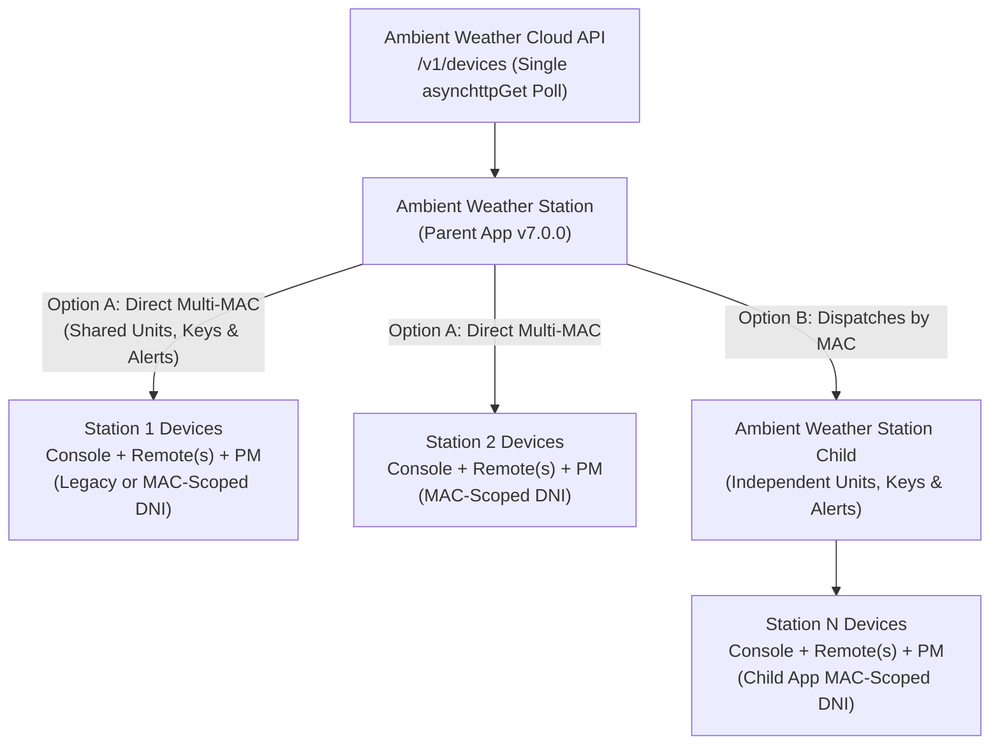

# Ambient Weather® Station™ (AWS) 
*Hubitat® Integration for Ambient Weather® Stations by SanderSoft™*
### Hubitat AWS Suite Version: 7.0.0

[Change-log & Version Release Features](https://github.com/KurtSanders/STAmbientWeather/wiki/Features-by-Version)

#### You must install [Hubitat Package Manager](https://hubitatpackagemanager.hubitatcommunity.com/) and install Ambient Weather Station application via HPM. Search in HPM for the keyword 'Weather'.

[Hubitat Community Support WebLink](https://community.hubitat.com/t/release-ambient-weather-station-app/128838) 

---

### Description:

 

A custom Hubitat® SmartApp integrates weather/environmental data generated from one or more personal [Ambient Weather® stations](https://www.ambientweather.com/ambientnet.html), sensors, and accessories.  

This Hubitat® application provides integration to your [AmbientWeather.net](https://ambientweather.net/) weather data via the [AmbientWeather API](https://ambientweather.docs.apiary.io/#) using a single asynchronous poll (`asynchttpGet`) across all stations on your account. The HE user can set the polling rate of their weather and sensor data from either a manual or automatic refresh cycle (1 min to 180 mins (3 hours)).

### What's New in Version 7.0.0
* **Multi-Station Support (Two Flexible Modes, One API Poll):**
  * **Option A — Direct Multi-MAC (Shared Settings):** Select multiple weather stations directly in the main app. All selected stations share the same units of measure, data-key filter, and alert rules.
  * **Option B — Per-Station Child Apps (Independent Settings):** Add an optional **Ambient Weather Station Child** app for any station that needs its own independent units, data-key filter, sensor labels, or alert thresholds. Stations assigned to a Child App are automatically hidden from Option A (and from other Child Apps) so you never get duplicate devices.
* **Single Asynchronous API Poll (`asynchttpGet`):** Both Option A and Option B share a single non-blocking `/v1/devices` call per polling cycle, keeping hub CPU usage low and avoiding Ambient Weather API rate limits.
* **Leaner `state` & Code Cleanup:** Removed full JSON payload caching from hub `state`, removed ~350 lines of legacy SmartThings/unused NWS code, fixed inside-console naming prompts (so multiple consoles aren't all defaulted to `Kitchen`), and fixed app label status badge stacking.

---

### What Happens to Your Existing Devices When Upgrading?
* **Existing Single-Station Users (Staying in Option A):** **Nothing breaks.** Your existing `weatherStationMac` setting is preserved, and the app automatically falls back to your legacy Device Network IDs (`MyAmbientWeatherStation`, `MyAmbientRemoteSensorN`, `MyAmbientParticulateMonitor`). All existing devices, dashboards, and Rule Machine rules continue working without any changes.
* **Adding a 2nd Station:**
  * If you add your 2nd station in **Option A**, your 1st station keeps its legacy DNIs and the 2nd station gets new MAC-scoped DNIs.
  * If you add your 2nd station as a **Child App (Option B)** while keeping your 1st station in **Option A**, your existing rules and dashboards remain untouched.
* **Moving an Existing Station into a Child App (Option B):** Because each Child App has its own `app.id`, moving an *already-installed* station from Option A into a Child App will create **new** child devices under that Child App. You'll need to update any rules/dashboards to point to the new Child App devices and remove the old orphaned devices under the parent app.

### Multi-Station Architecture (v7.0.0+)

Version 7.0.0 supports multiple Ambient Weather stations from a **single API poll** using either (or a mix) of two modes—choose **one mode per station**:

* **Option A — Direct Multi-MAC (Shared Settings):** Select one or more stations directly in the main app. All stations share the same units of measure, data-key filter, and alert thresholds.
* **Option B — Per-Station Child Apps (Independent Settings):** Create an **Ambient Weather Station Child** app for any station that needs its own units of measure, data-key filter, or alert thresholds. Stations assigned to a Child App are automatically excluded from Option A (and vice versa).

#### Upgrading from v6.x
* **Existing Single-Station Users (Option A):** Seamless upgrade—existing devices keep their legacy DNIs, so dashboards, Rule Machine rules, and sensor names stay intact.
* **Adding a 2nd Station:** Keep your original station in **Option A** and either add the new station in **Option A** or create a **Child App (Option B)** for it.
* **Moving an Existing Station to a Child App:** Because a Child App has its own `app.id`, moving an existing station out of Option A into a Child App creates new devices under the Child App (requiring rule/dashboard updates and removal of the old parent devices).

### Supported Ambient Weather Station Brand Devices and Accessories:

* [Ambient Weather Station](https://ambientweather.com/ws-2902-smart-weather-station) with Internet Access
* [PM25](https://ambientweather.com/ampm25.html)/[AQIN](https://ambientweather.com/indoor-wireless-air-quality-monitor-aqin) Sensors
* Soil Sensors
* Wind Sensor
* Rain Sensor
* Up to 8 Weather Remote Sensors

#### AWS Settings Examples
* Preference Screens

 

* Import Selection 
 

#### Ambient Weather Station Device Information :arrow_right: Hubitat™

[View Ambient Weather Station's Device Data Specs](https://github.com/ambient-weather/api-docs/wiki/Device-Data-Specs)

| HE Capability | HE Attribute | Reported Type |
|:------------:|:-------------------|:-------------------:|
|capability|Battery|Battery|
|capability|IlluminanceMeasurement|Illuminance|
|capability|Refresh|Refresh|
|capability|RelativeHumidityMeasurement|Humidity|
|capability|Sensor| N/A |
|capability|TemperatureMeasurement|Temperature|
|capability|UltravioletIndex|Ultraviolet|

| HE Attribute | HE Device State Data Key | Reported Type |
|:------------:|:-------------------|:-------------------:|
|attribute|baromabsin_display|string|
|attribute|baromabsin|number|
|attribute|baromrelin_display|string|
|attribute|baromrelin|number|
|attribute|batt_lightning|number|
|attribute|city|string|
|attribute|dailyrainin_display|string|
|attribute|dailyrainin|number|
|attribute|date|string|
|attribute|date|string|
|attribute|dateutc|string|
|attribute|dewPoint_display|string|
|attribute|dewpoint|number|
|attribute|dewPoint|number|
|attribute|eventrainin_display|string|
|attribute|eventrainin|number|
|attribute|feelsLike_display|string|
|attribute|feelslike|number|
|attribute|feelsLike|number|
|attribute|hourlyrainin_display|string|
|attribute|hourlyrainin|number|
|attribute|humidity_display|string|
|attribute|humidityin_display|string|
|attribute|humidityin|number|
|attribute|lastRain|string|
|attribute|lastRainDuration|string|
|attribute|lastSTupdate|string|
|attribute|lightning_day|number|
|attribute|lightning_distance|number|
|attribute|lightning_hour|number|
|attribute|lightning_time|number|
|attribute|location|string|
|attribute|macAddress|string|
|attribute|maxdailygust_display|string|
|attribute|maxdailygust|number|
|attribute|monthlyrainin_display|string|
|attribute|monthlyrainin|number|
|attribute|pwsName|string|
|attribute|scheduleFreqMin|string|
|attribute|solarradiation_display|string|
|attribute|solarradiation|number|
|attribute|tempf_display|string|
|attribute|tempinf_display|string|
|attribute|tempinf|number|
|attribute|totalrainin_display|string|
|attribute|totalrainin|number|
|attribute|ultravioletIndexDisplay|string|
|attribute|version|string|
|attribute|weeklyrainin_display|string|
|attribute|weeklyrainin|number|
|attribute|wind_cardinal|string|
|attribute|wind|number|
|attribute|winddir|string|
|attribute|windDirection|number|
|attribute|winddirection|string|
|attribute|windgustmph_display|string|
|attribute|windgustmph|number|
|attribute|windSpeed|number|
|attribute|windspeedmph_display|string|
|attribute|windspeedmph|number|
|attribute|windVector|string|

### Requirements:
* You must create your own and have access to the following **private data strings** displayed at your [AWS Account](https://ambientweather.net/account)  and [My Devices](https://ambientweather.net/devices) webpages. 
    * [Locate your weather station's MAC address](https://ambientweather.net/devices)
    * [Locate your Ambient API key](https://ambientweather.net/account)
